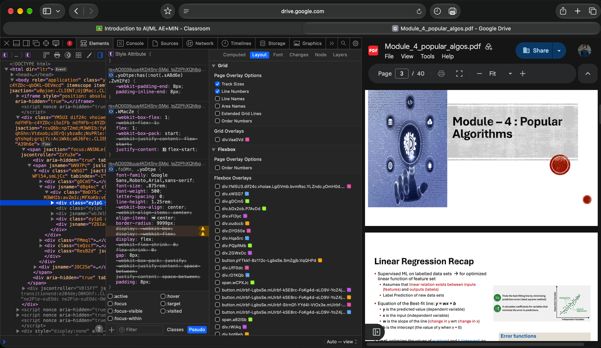
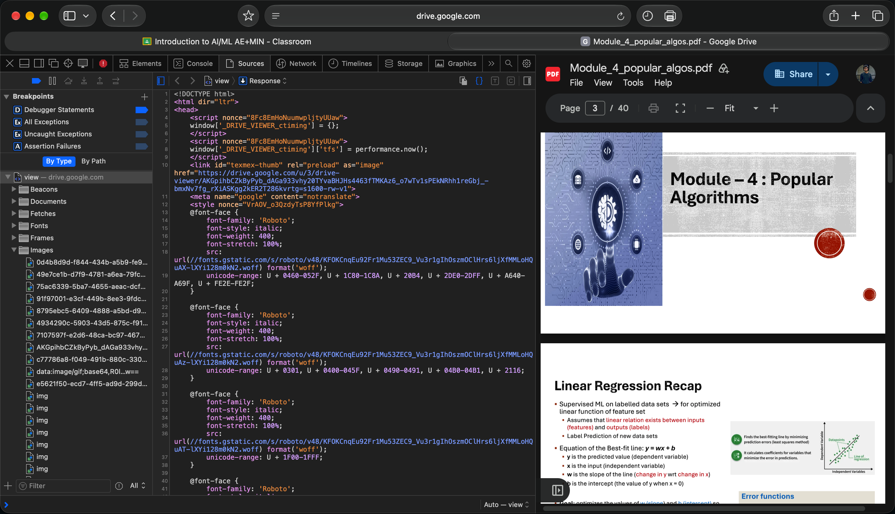
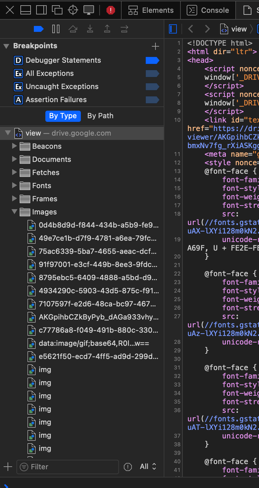
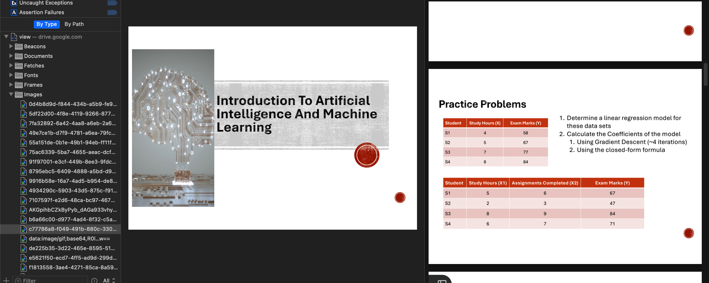
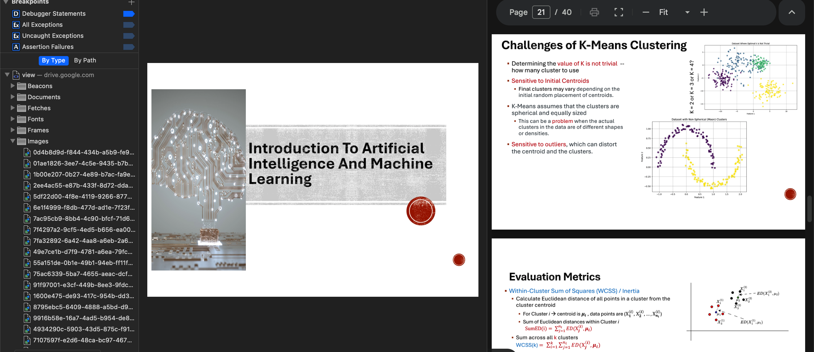
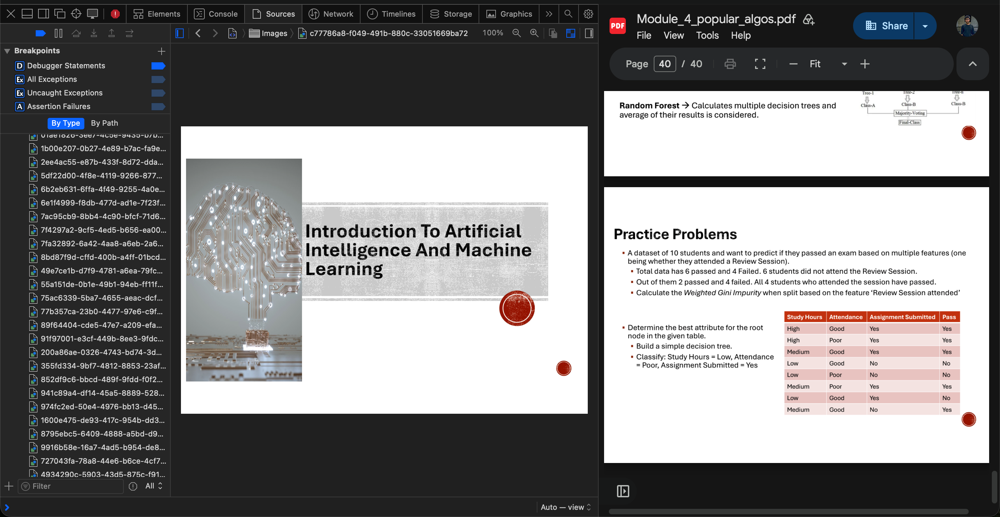
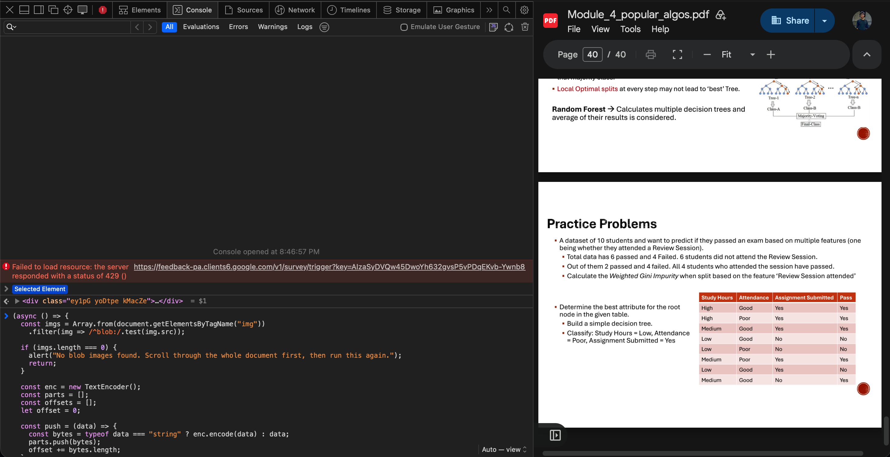
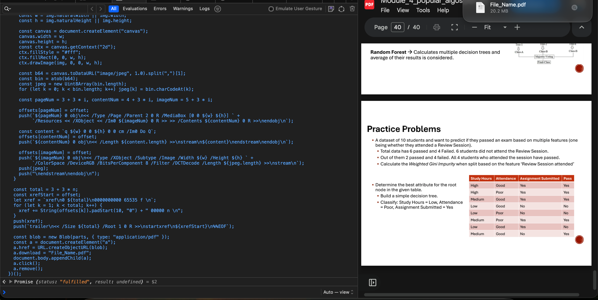
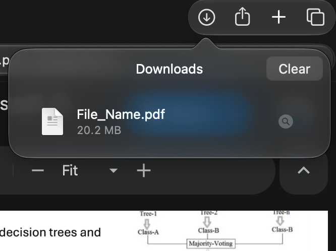
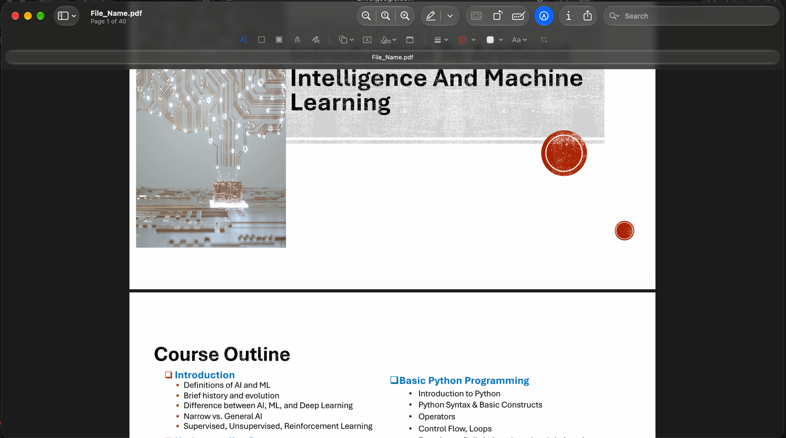

# Saving a View-Only Google Drive PDF to Annotate on My iPad

My professor shared a PDF through Google Classroom, uploaded on Drive with downloading disabled. I wanted to mark lines and objects on it with my iPad, so I needed a copy I could open in an annotation app. This is how I got one, and how the script behind it works.

---

## How the browser handles the file

Drive does not send the PDF as one file. Each page is delivered as an image and kept temporarily in the browser's memory. In Safari's Web Inspector, the Elements tab shows the Drive viewer's page structure, but the useful part is the Sources tab.

<p align="center">
  <br>
  <em>The Drive viewer on the right, with the inspector open on the left.</em>
</p>

Open the Sources tab and expand the Images folder, and every page shows up as its own image file.

<p align="center">
  <br>
  <em>The Images folder in the Sources tab, listing the page images.</em>
</p>

<p align="center">
  <br>
  <em>A closer look at the same folder.</em>
</p>

Click any of those entries and the inspector previews it. The preview below is page 1 of the document, shown as a plain picture.

<p align="center">
  <br>
  <em>Selecting an image in the folder shows the page as a picture.</em>
</p>

As you scroll down the document, more pages get rendered on screen, and more images appear in that folder. The next three screenshots show the list growing as the scroll position moves from the start to page 21 and then to page 40.

<p align="center">
  <br>
  <em>More entries appear after scrolling further.</em>
</p>

<p align="center">
  <br>
  <em>Around page 21 the list is noticeably longer.</em>
</p>

<p align="center">
  <br>
  <em>At page 40 of 40, the folder holds the rendered pages.</em>
</p>

This also means you must scroll to the very bottom before running the script, otherwise the pages that were never loaded will be missing from the final PDF.

---

## What the script does

The script works like a person who collects all the page pictures, puts them in order, and binds them into a booklet. It first finds every image on the page whose address starts with "blob:", which are the temporary page images. For each one, it paints the image onto a blank white canvas at its full original size, then asks the canvas for a JPEG version. That JPEG arrives as a long string of text letters, so the script converts it back into raw bytes, much like turning a fax code back into the actual picture. Painting on white first matters because JPEG has no transparency, and without it any see-through areas would turn black. Finally, the script bundles all the pieces into one file, creates an invisible download link pointing to it, clicks it automatically, and removes it. That is why the download simply starts when the code finishes.

---

## Why not use a library

My first attempt loaded the jsPDF library from the internet, and Drive blocked it with a Trusted Types security error. So the final script builds the PDF file by hand and needs nothing from outside, which means the security rule never triggers.

---

## Running it

After scrolling to the end of the document, open the Console tab, paste the full script (it is at the bottom of this file), and press Enter.

<p align="center">
  <br>
  <em>The script pasted into the Console while the document sits at page 40.</em>
</p>

---

## Code explanation

**Collecting the pages**

```javascript
const imgs = Array.from(document.getElementsByTagName("img"))
  .filter(img => /^blob:/.test(img.src));
```

This finds every image on the page and keeps only the ones with a blob address, which are the rendered document pages.

**The file builder**

```javascript
const push = (data) => {
  const bytes = typeof data === "string" ? enc.encode(data) : data;
  parts.push(bytes);
  offset += bytes.length;
};
```

A PDF needs exact byte positions, so every write goes through this function. It stores the chunk and keeps a running count of bytes written.

**Image to JPEG bytes**

```javascript
ctx.fillStyle = "#fff";
ctx.fillRect(0, 0, w, h);
ctx.drawImage(img, 0, 0, w, h);
const b64 = canvas.toDataURL("image/jpeg", 1.0).split(",")[1];
const bin = atob(b64);
const jpeg = new Uint8Array(bin.length);
for (let k = 0; k < bin.length; k++) jpeg[k] = bin.charCodeAt(k);
```

The image is drawn on a white canvas, exported as a JPEG at maximum quality, and decoded from text back into raw bytes.

**Three objects per page**

```javascript
/MediaBox [0 0 w h]
q w 0 0 h 0 0 cm /Im0 Do Q
/Filter /DCTDecode /Length ${jpeg.length}
```

Each page is made of a page object sized to the image, a drawing command that stretches the image to fill the page, and the image object itself. `DCTDecode` tells the PDF reader the data is already a JPEG, so the bytes are embedded untouched. The `Length` value must match the byte count exactly.

**The index at the end**

```javascript
offsets[imageNum] = offset;
xref += String(offsets[k]).padStart(10, "0") + " 00000 n \n";
```

The script records where every object starts, then writes a table at the end of the file listing those positions. A PDF reader reads this table first so it can jump straight to any page.

**Delivering the file**

```javascript
const blob = new Blob(parts, { type: "application/pdf" });
a.href = URL.createObjectURL(blob);
a.download = "File_Name.pdf";
a.click();
```

All the bytes are combined into one file, and a hidden download link is clicked automatically.

---

## Result

When the script finished, the Console showed the promise as fulfilled and the download appeared in Safari.

<p align="center">
  <br>
  <em>The Console reports success and File_Name.pdf (20.2 MB) shows up in the download banner.</em>
</p>

<p align="center">
  <br>
  <em>The Downloads list showing File_Name.pdf at 20.2 MB.</em>
</p>

Opening it in Preview shows a 40 page document matching the original, ready to send to the iPad and annotate.

<p align="center">
  <br>
  <em>File_Name.pdf in Preview, page 1 of 40.</em>
</p>

Because every page is a picture, the text in the new PDF cannot be selected or searched, though annotating on top of it works fine.

---

## Note

This is for personal study copies of material shared with you. The file owner disabled downloading, so don't redistribute the result.

---

## Full script

```javascript
(async () => {
  const imgs = Array.from(document.getElementsByTagName("img"))
    .filter(img => /^blob:/.test(img.src));

  if (imgs.length === 0) {
    alert("No blob images found. Scroll through the whole document first, then run this again.");
    return;
  }

  const enc = new TextEncoder();
  const parts = [];
  const offsets = [];
  let offset = 0;

  const push = (data) => {
    const bytes = typeof data === "string" ? enc.encode(data) : data;
    parts.push(bytes);
    offset += bytes.length;
  };

  const n = imgs.length;
  // Object numbers: 1 = catalog, 2 = pages, then per page: 3+3i = page, 4+3i = content, 5+3i = image
  push("%PDF-1.4\n");

  offsets[1] = offset;
  push("1 0 obj\n<< /Type /Catalog /Pages 2 0 R >>\nendobj\n");

  const kids = imgs.map((_, i) => `${3 + 3 * i} 0 R`).join(" ");
  offsets[2] = offset;
  push(`2 0 obj\n<< /Type /Pages /Kids [${kids}] /Count ${n} >>\nendobj\n`);

  for (let i = 0; i < n; i++) {
    const img = imgs[i];
    const w = img.naturalWidth || img.width;
    const h = img.naturalHeight || img.height;

    const canvas = document.createElement("canvas");
    canvas.width = w;
    canvas.height = h;
    const ctx = canvas.getContext("2d");
    ctx.fillStyle = "#fff";
    ctx.fillRect(0, 0, w, h);
    ctx.drawImage(img, 0, 0, w, h);

    const b64 = canvas.toDataURL("image/jpeg", 1.0).split(",")[1];
    const bin = atob(b64);
    const jpeg = new Uint8Array(bin.length);
    for (let k = 0; k < bin.length; k++) jpeg[k] = bin.charCodeAt(k);

    const pageNum = 3 + 3 * i, contentNum = 4 + 3 * i, imageNum = 5 + 3 * i;

    offsets[pageNum] = offset;
    push(`${pageNum} 0 obj\n<< /Type /Page /Parent 2 0 R /MediaBox [0 0 ${w} ${h}] ` +
         `/Resources << /XObject << /Im0 ${imageNum} 0 R >> >> /Contents ${contentNum} 0 R >>\nendobj\n`);

    const content = `q ${w} 0 0 ${h} 0 0 cm /Im0 Do Q`;
    offsets[contentNum] = offset;
    push(`${contentNum} 0 obj\n<< /Length ${content.length} >>\nstream\n${content}\nendstream\nendobj\n`);

    offsets[imageNum] = offset;
    push(`${imageNum} 0 obj\n<< /Type /XObject /Subtype /Image /Width ${w} /Height ${h} ` +
         `/ColorSpace /DeviceRGB /BitsPerComponent 8 /Filter /DCTDecode /Length ${jpeg.length} >>\nstream\n`);
    push(jpeg);
    push("\nendstream\nendobj\n");
  }

  const total = 3 + 3 * n;
  const xrefStart = offset;
  let xref = `xref\n0 ${total}\n0000000000 65535 f \n`;
  for (let k = 1; k < total; k++) {
    xref += String(offsets[k]).padStart(10, "0") + " 00000 n \n";
  }
  push(xref);
  push(`trailer\n<< /Size ${total} /Root 1 0 R >>\nstartxref\n${xrefStart}\n%%EOF`);

  const blob = new Blob(parts, { type: "application/pdf" });
  const a = document.createElement("a");
  a.href = URL.createObjectURL(blob);
  a.download = "File_Name.pdf";
  document.body.appendChild(a);
  a.click();
  a.remove();
})();
```
